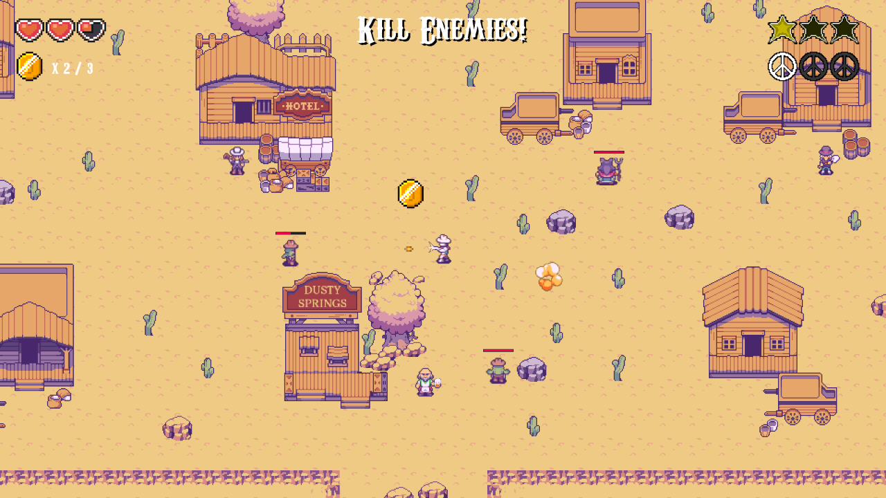

# WildWestOutlaw

## Description

Welcome to WildWestOutlaw, an exciting adventure game set in the wild west! In this game, you'll step into the boots of a notorious outlaw and navigate the rugged landscape of the old west. Engage in thrilling shootouts, interact with intriguing characters, and immerse yourself in the rich, atmospheric world of the wild west.



## Getting Started

To run the game, follow these simple steps:

1. Make sure you have **Java 21 or newer** (a JDK) installed on your system. You don't need to install Maven, the included Maven Wrapper downloads it on first use.
2. Clone the repository and navigate to the directory where the game files are located:

   ```sh
   git clone https://github.com/davidmrc6/wild-west-outlaw.git
   cd wild-west-outlaw
   ```

3. Run the game:

   ```sh
   ./mvnw compile exec:java
   ```

   On Windows, use `mvnw.cmd compile exec:java` instead.

Alternatively, you can build a standalone jar and run that:

```sh
./mvnw package
java -jar target/wild-west-outlaw.jar
```

Enjoy your adventure in the wild west!

### Controls

| Key | Action |
| --- | --- |
| `W` `A` `S` `D` | Move (and navigate menus with `W` / `S`) |
| `↑` `↓` `←` `→` | Shoot in that direction (two at once for diagonals), even while walking another way |
| `Space` | Shoot where you're facing |
| `Enter` | Talk to characters / confirm menu choices |
| `P` | Pause |
| `M` | Sound on / off |
| `F11` | Fullscreen on / off |
| `F3` | Show the hitboxes |

## Known Bugs

There are no known bugs at the moment. The visual bugs on certain graphics processing units (GPUs) and the inaccurate hitboxes from earlier versions have been fixed.

## Gameplay Tips

Here are some tips to enhance your gaming experience:

- To progress in the game, walk up to other characters and press the `Enter` key to initiate conversations or interactions (keep pressing it to go through a conversation).
- Start your adventure by talking to the bartender, who can provide valuable information and quests to kickstart your journey as an outlaw in the wild west.

## Learning Topics

We would like to highlight two key learning topics that were instrumental in the development of WildWestOutlaw:

### Pathfinding Algorithm Implementation

In WildWestOutlaw, we've implemented a pathfinding algorithm to provide dynamic and realistic movement for characters and objects within the game world. This algorithm allows characters to navigate the complex terrain of the wild west, avoiding obstacles and making their interactions more engaging. The pathfinding algorithm ensures that NPCs move intelligently, adding depth to the game's world and enhancing the player's experience.

### Double Buffering of Images

To create a smooth and flicker-free visual experience, we employed the double buffering technique to render images in WildWestOutlaw. Double buffering significantly improves the game's graphical performance by eliminating flickering and screen tearing. It achieves this by rendering images off-screen and then swiftly swapping them onto the display, resulting in a visually pleasing and immersive gaming experience.

We believe that the implementation of these two learning topics has enriched the quality and realism of the game, making WildWestOutlaw an even more enjoyable adventure in the wild west.

## Credits

We would like to extend our gratitude to the following individuals and resources that contributed to the creation of WildWestOutlaw:

- **RyiSnow**: For providing inspiration through their [YouTube series](https://www.youtube.com/watch?v=om59cwR7psI&list=PL_QPQmz5C6WUF-pOQDsbsKbaBZqXj4qSq).
- **Estúdio Vaca Roxa**: For their remarkable "Generic OLDWEST" graphics pack, which added authenticity and ambiance to our wild west world. You can find their graphics pack [on itch.io](https://bakudas.itch.io/generic-oldwest-pack).
- **GGBotNet**: For the "Pixeloid Sans" font used in the dialogues, released under the [SIL Open Font License](https://scripts.sil.org/OFL). You can find it at [ggbot.net](https://ggbot.net).

Thank you for playing WildWestOutlaw, and we hope you enjoy your adventure in the wild west! If you encounter any issues or have feedback, please feel free to reach out to us. Happy gaming!
